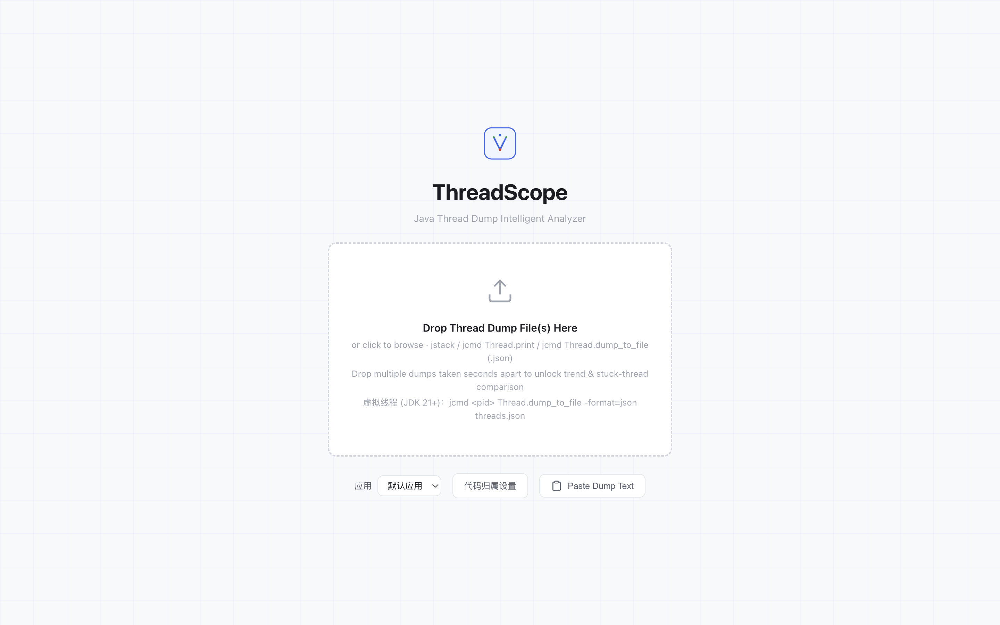
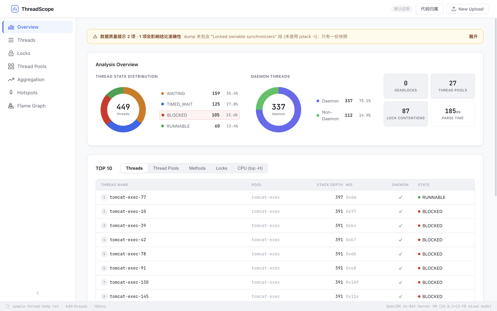
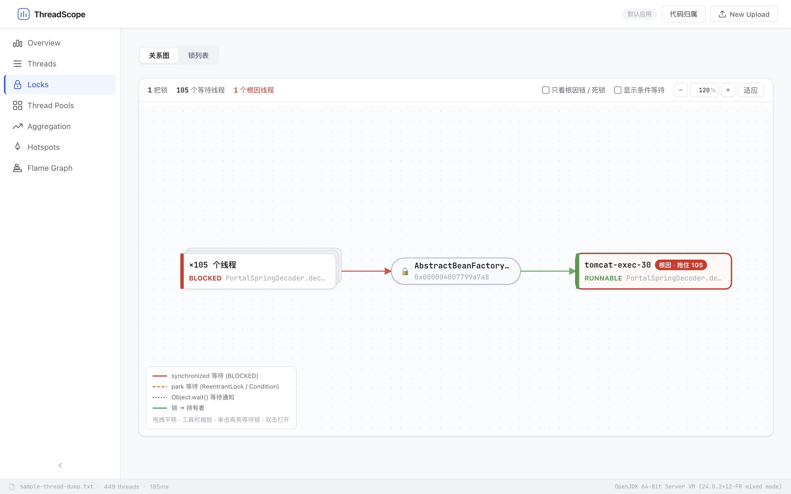
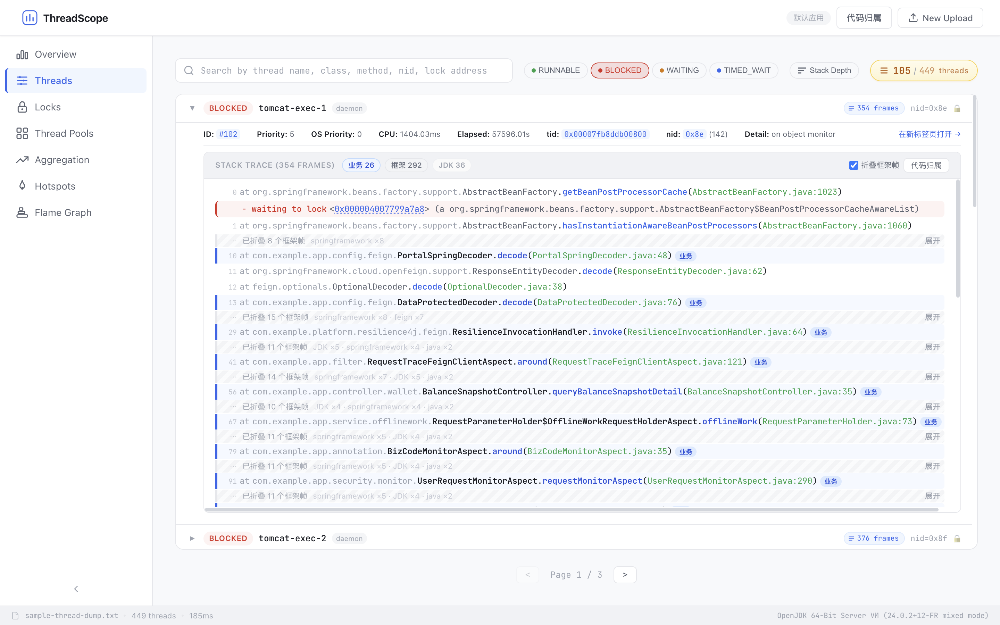
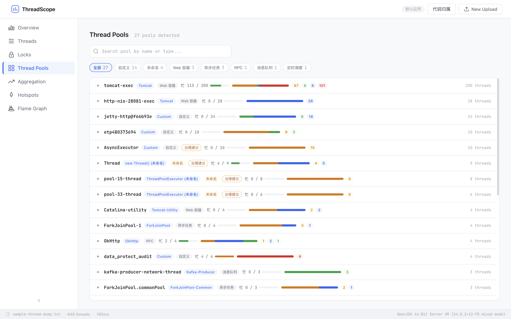
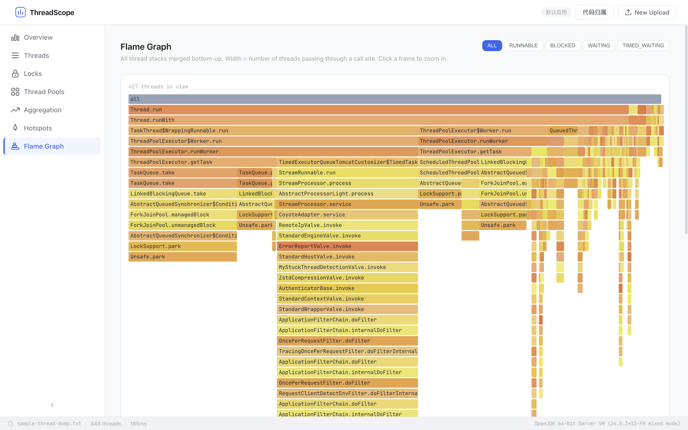

# ThreadScope

Java 线程 Dump 智能分析平台。上传或粘贴 JVM Thread Dump 文本，即可获得死锁检测、锁链根因定位、线程池洞察、方法热点、火焰图、多 Dump 差分对比等可视化分析结果。

## 界面

下面是同一份 JDK 24 HotSpot dump（449 个线程）的主要界面。业务包已配置为示例前缀，栈帧按 JDK / 框架 / 业务三层着色。

### 上传

拖入一个或多个 dump，或直接粘贴文本。上传前可以选择已保存的应用配置，把对应的业务包前缀带给分析引擎。



### 概览

状态分布、Daemon 比例、死锁 / 线程池 / 锁竞争 / 解析耗时，以及按栈深排序的 TOP 10。数据不完整时，顶部会说明对结论的影响和补抓方式。诊断风险卡片在概览下方，点开可看到受影响线程并跳到对应线程或锁。



### 锁等待关系图

等待者、锁、持有者分层排布，根因线程在右侧。同一位置等待的线程收成一个分组节点。下图里一把 Spring Bean 锁拖住了 105 个 BLOCKED 线程。



### 线程与代码归属

线程列表支持按状态、线程类别、名称、方法、nid、锁地址筛选。展开后连续的框架帧会折叠，业务帧高亮，并可以按仓库模板跳到源码。



### 线程池

按 Web、RPC、消息队列、定时调度、未命名等类别归类。空闲和忙碌按栈判定，状态分布画在同一条色带上。看不出业务含义的池会给出命名建议。



### 火焰图

全部线程的堆栈自底向上合并，宽度是经过该调用点的线程数。可按状态过滤，点击某一帧放大子树。



## 技术栈

| 层 | 技术 |
|---|------|
| 后端 | Java 21 (Virtual Threads) · Spring Boot 3.3 · Gradle (Kotlin DSL) · Caffeine Cache |
| 前端 | Vue 3 · TypeScript · Vite · UnoCSS · Pinia |

## 项目结构

```
thread_scope/
├── threadscope-backend/       # Spring Boot 后端服务
│   └── src/main/java/com/threadscope/
│       ├── controller/        # REST 接口
│       ├── service/           # 业务编排
│       ├── engine/
│       │   ├── parser/        # Thread Dump 词法/语义解析、多 Dump 切分
│       │   ├── analyzer/      # 死锁、锁链根因、线程池、热点、对比、健康度分析
│       │   └── pattern/       # Dump 正则模式
│       ├── model/             # 领域模型
│       ├── dto/               # 传输对象
│       └── exception/         # 统一异常处理
├── threadscope-frontend/      # Vue 3 前端
│   ├── src/
│   │   ├── components/        # 业务组件 (仪表盘/线程/锁/热点/聚合/火焰图/对比)
│   │   ├── api/               # 后端 API 调用
│   │   ├── stores/            # Pinia 状态管理
│   │   ├── router/            # 路由
│   │   └── types/             # TypeScript 类型
│   ├── Dockerfile
│   └── nginx.conf
├── samples/                   # 可直接拖入的示例 dump
├── docs/images/               # README 界面截图
├── docker-compose.yml
└── README.md
```

## 核心功能

### 解析

- **Thread Dump 解析** — 词法 + 语义两阶段解析，Virtual Threads 并行处理，支持最多 50,000 个线程；单次上传上限 50MB
- **格式兼容** — HotSpot JVM (Java 8 ~ 24+) 经典与新格式线程头、SMR 段、构造器/lambda 等特殊方法名；
  `jcmd <pid> Thread.dump_to_file` 的 JSON 与纯文本格式 (含全部虚拟线程)
- **编码自动识别** — UTF-8 / UTF-16 (含 Windows PowerShell 重定向产生的带 BOM 文件) / GBK，也可通过 `charset` 参数指定
- **多 Dump 自动切分** — 单个文件内含多段 `Full thread dump`（如 `kill -3` 输出日志）时自动按段切分，并识别 jstack 时间戳
- **多文件上传** — 一次拖入多个间隔抓取的 dump 文件，按文件名排序自动进入对比分析；每份快照都做完整分析，可在顶栏切换
- **线程身份** — 以 Java 线程 ID (`#N`) 作为唯一标识，重名线程不会被合并；跨快照配对时识别 JVM 重启
- **数据质量提示** — 未用 `jstack -l`、缺少 `cpu=` 字段、只有单份快照、JVM 重启、状态为推断等情况会在报告顶部说明影响与补抓方式

### 分析引擎

- **死锁检测** — 三重策略：JVM 自报告段解析（支持多段切分）、synchronized 锁等待图三色 DFS 环检测、JUC 锁 (ReentrantLock/Semaphore) 保守图检测
- **锁等待链根因定位** — 沿 "等待者 → 持有者" 边做传递闭包，把几十条锁记录收敛成"元凶线程 X 拖住了 N 个线程"的结论
- **IO 型 RUNNABLE 细分** — 识别栈顶停在 native socket/文件读写的"假 RUNNABLE"线程，区分 CPU 瓶颈与下游 IO 瓶颈，并带上共同的业务调用点
- **已知病症指纹库** — 内置高频生产故障模式规则，命中即给出病名级诊断与处置建议：
  - 数据库连接池耗尽 (HikariCP / Druid / DBCP)、Redis 同步等待 (Lettuce / Redisson)
  - HTTP 客户端连接池耗尽 (Apache HttpClient 4/5)
  - 对象池耗尽 (Jedis / Commons-Pool)
  - 类加载锁竞争、日志 Appender 锁竞争、异步日志队列写满 (Log4j2 RingBuffer / Logback AsyncAppender)
  - 疑似慢 SQL（线程卡在数据库响应读取）、同步 DNS 解析阻塞、SecureRandom 熵源阻塞
  - 正则灾难性回溯、HashMap 并发死循环、异常风暴 (大量线程在 fillInStackTrace)
  - 公共 ForkJoinPool 饥饿、无超时等待 Future、Spring 单例创建锁竞争
- **虚拟线程分析** — 识别载体线程 (`Carrying virtual thread #N`)、虚拟线程按容器统计、pinning 检测 (synchronized 内阻塞 / native 帧)，并区分 JDK 21~23 与 JDK 24+ (JEP 491) 的行为
- **健康度报告** — 十余项专家规则综合评估：死锁、阻塞风暴、BLOCKED 比例、线程池饱和、CPU 热点 (含 JDK 栈顶)、IO 瓶颈、线程总量异常、非 daemon 线程审计、线程频繁创建 (churn)、Finalizer 积压、异常深栈（递归风险）、未命名线程池；阈值可配置。概览里每条风险可点开，并跳到相关线程或锁
- **线程池洞察** — 识别 Tomcat / Jetty / Undertow / Vert.x / Spring @Async / Quartz / XXL-Job / Dubbo / gRPC / Hystrix / Kafka / RabbitMQ / RocketMQ / Lettuce / Redisson 等线程池；按栈判定空闲与忙碌 (在任务中等连接池、Future 的 WAITING 线程计为忙碌)；对 `pool-N-thread-M` 等未命名线程池给出命名治理建议。页面可按类别筛选，并用色带看每个池的状态分布
- **方法热点分析** — 聚合栈帧，定位高频调用方法。概览里的方法榜点进去后，会在线程列表中按这个方法搜索
- **堆栈聚合** — 相同调用栈的线程自动分组，智能生成可读的组标签

### 代码归属

栈帧分成 JDK、三方框架、业务代码三层。业务包前缀优先于内置框架列表，方便企业代码落在 `com.alibaba.*` 这类前缀下时仍算业务代码。

- **应用档案** — 按应用保存名称、业务包前缀和源码仓库模板，存在浏览器本地。上传页选择当前应用后，这些前缀会随请求提交
- **候选包** — 分析完成后，设置里列出本次 dump 中 JDK / 已知框架之外的包前缀，可一键加入
- **即时着色** — 改业务包后，已打开页面的栈帧高亮和折叠马上更新。诊断文案里的业务调用点在下次上传时按当时的前缀计算
- **框架帧折叠** — 连续的非业务帧收成一行（如 `springframework ×8 · feign ×7`），可逐段展开。栈顶两帧始终可见
- **源码跳转** — 模板支持 `{path}` `{file}` `{line}` `{class}` `{package}` `{method}`。多模块项目按包前缀分别配置，最长前缀优先。内置 GitLab、GitHub、Gitea、IntelliJ、VS Code 模板

未配置任何业务包时，JDK 与已知框架之外的代码都按业务代码推断。

### 多 Dump 差分对比

单个 dump 是瞬间快照，无法区分"正好在等"和"一直卡着"。上传多份间隔抓取的 dump 后自动进行：

- **栈不动检测** — 同一线程在所有 dump 中栈指纹完全一致（排除池内正常空闲），即真挂起/死循环/长事务
- **CPU 差值榜** — `cpu=` 是累计值，只有 dump 之间的差值才反映真实 CPU 消耗
- **线程数趋势** — 按名称前缀聚合的数量变化，直接暴露线程泄漏

多份快照通过 ID 寻址：`{id}` 为最新一份，`{id}~s0`、`{id}~s1` … 为第 N 份，所有分析接口通用。顶栏可按快照切换，每个快照都有独立的健康度和死锁数。

### 可视化

- **锁等待关系图** — 默认视图。根因线程居右，同一等待位置的大量线程折叠为分组节点；死锁环高亮。支持拖拽、缩放、适应画布；可只看根因链，条件等待（无持有者的 `Condition.await` / `Object.wait`）默认隐藏。单击高亮整条等待链，双击打开线程
- **锁列表** — 按等待者数量排序，展开后可看到持有者、等待线程和锁类型，并跳到线程详情
- **火焰图** — 所有线程堆栈自底向上合并成调用树，宽度 = 经过该调用点的线程数，支持按状态过滤与点击缩放
- **top -H CPU 关联** — 在概览的 CPU 标签页粘贴 `top -H -p <pid>` 输出，OS 线程 PID 自动映射回 Java 线程 nid
- **线程详情标签** — 从概览、锁图、线程池或对比视图点进来的线程以标签打开，列表本身保留
- **仪表盘** — 状态分布环形图、TOP 10 列表（线程/线程池/方法/锁/CPU）、风险卡片。底栏显示文件名、线程数、解析耗时、dump 格式和 JVM 版本

## 快速开始

### 环境要求

- JDK 21+
- Node.js 18+
- npm 9+

### 启动后端

```bash
cd threadscope-backend
./gradlew bootRun
```

服务默认监听 `http://localhost:8080`。

### 启动前端

```bash
cd threadscope-frontend
npm install
npm run dev
```

开发服务器启动后打开浏览器访问即可。

### 构建生产版本

```bash
# 前端
cd threadscope-frontend
npm run build          # 产物输出至 dist/

# 后端
cd threadscope-backend
./gradlew build        # 产物输出至 build/libs/
```

### 运行测试

```bash
cd threadscope-backend
./gradlew test
```

## 使用建议

获得高质量诊断的抓取方式：

```bash
# 间隔 5~10 秒抓取 3 份 dump（时间戳会被自动识别）
for i in 1 2 3; do jstack -l <pid> > dump-$i.txt; sleep 5; done

# 同时抓取线程级 CPU 快照，用于仪表盘的 CPU (top -H) 关联
top -H -b -n 1 -p <pid> > top-h.txt

# JDK 21+ 使用虚拟线程时，导出全部虚拟线程 (jstack 只能看到正在挂载的)
jcmd <pid> Thread.dump_to_file -format=json /tmp/threads.json
```

把 `dump-1.txt dump-2.txt dump-3.txt` 一起拖入上传区，即可解锁 **Comparison** 差分视图；
在 Overview 的 **CPU (top -H)** 标签页粘贴 `top-h.txt` 内容可定位 CPU 热点线程。

仓库里的 [`samples/virtual-threads.json`](samples/virtual-threads.json) 是一份 JDK 21 的 jcmd JSON 样例，拖进去即可看到虚拟线程、载体线程和 pinning。

分析报告在 JVM 内存中，默认保留 60 分钟，或在缓存里的线程总数超过上限时按权重淘汰。刷新页面后，只要缓存还在，用原来的分析链接可以重新打开。

## 主要 API

| 方法 | 路径 | 说明 |
|---|---|---|
| POST | `/api/v1/dump/upload` | 上传一个或多个 dump 文件（multipart，字段名 `file` 可重复；可选 `charset`、`businessPackages`、`applicationName`）。合计不超过 50MB |
| POST | `/api/v1/dump/paste` | 粘贴文本分析（可选 `businessPackages`、`applicationName`） |
| GET | `/api/v1/analysis/{id}/overview` | 概览（含快照列表、数据质量提示、虚拟线程报告、业务包与候选业务包） |
| GET | `/api/v1/analysis/{id}/threads` | 线程列表（筛选/搜索/分页；`kind=PLATFORM,VIRTUAL,CARRIER`） |
| GET | `/api/v1/analysis/{id}/thread?ref=` | 按线程标识 (`#N`) 或线程名查询单个线程 |
| GET | `/api/v1/analysis/{id}/locks` | 锁与死锁 |
| GET | `/api/v1/analysis/{id}/lock-graph` | 锁等待关系图（节点/边；`includeConditionWaits=true` 显示无持有者的条件等待） |
| GET | `/api/v1/config/code-layers` | JDK / 框架包前缀列表与默认业务包 |
| GET | `/api/v1/analysis/{id}/thread-pools` | 线程池 |
| GET | `/api/v1/analysis/{id}/stack-aggregations` | 堆栈聚合 |
| GET | `/api/v1/analysis/{id}/method-hotspots` | 方法热点 |
| GET | `/api/v1/analysis/{id}/comparison` | 多 dump 对比结果（单 dump 返回 204） |
| GET | `/api/v1/analysis/{id}/calltree?state=` | 调用树（火焰图数据源） |
| POST | `/api/v1/analysis/{id}/cpu-correlation` | top -H 输出关联 |

`{id}` 为最新一份快照。同一次上传里的更早快照用 `{id}~s0`、`{id}~s1` … 访问，上面所有分析接口都适用。

## Docker 部署

### 环境要求

- Docker 20+
- Docker Compose v2+

### 一键启动

```bash
cp .env.example .env   # 按需修改管理员账号密码
docker compose up -d --build
```

### 登录与权限

除健康检查外，所有接口都需要登录。首次启动（库里还没有用户）时按 `.env` 里的 `THREADSCOPE_ADMIN_USERNAME` / `THREADSCOPE_ADMIN_PASSWORD` 创建管理员；密码留空则生成随机临时密码，用 `docker compose logs backend | grep "temporary password"` 查看，首次登录必须修改。

| 角色 | 权限 |
|---|---|
| 管理员 | 用户管理（创建、停用、改角色、重置密码、删除），删除任何 JFR 报告 |
| 普通用户 | 上传与查看全部分析，只能删除自己上传的 JFR 报告 |

- 管理员在「用户管理」页创建账号，系统生成一次性临时密码，用户首次登录后强制修改。
- 账号被停用、删除、重置密码或改角色后，已登录的会话立即失效。
- 同一 IP 对同一账号连续输错 5 次锁定 15 分钟；nginx 另对登录接口按 IP 限流。
- 忘记管理员密码：在 `.env` 中设置 `THREADSCOPE_ADMIN_PASSWORD` 和 `THREADSCOPE_RESET_ADMIN_PASSWORD=true`，执行 `docker compose up -d` 后即重置，之后改回 `false`。
- 当前通过 HTTP 访问时密码和会话 cookie 是明文传输的，建议在云服务器安全组里只放行办公网出口 IP；以后启用 HTTPS 后把 `THREADSCOPE_COOKIE_SECURE` 改为 `true`。

构建前端镜像时如果访问官方 npm 源较慢，可在 `.env` 中设置：

```bash
NPM_REGISTRY=https://registry.npmmirror.com
```

启动完成后访问 `http://<服务器IP>:5173` 即可使用。

### 停止服务

```bash
docker compose down
```

### 自定义端口

修改 `docker-compose.yml` 中 frontend 的端口映射，例如改为 `8888:80`：

```yaml
  frontend:
    ports:
      - "8888:80"
```

默认端口为 `5173`。

## 配置

`application.yml` 中 `threadscope.analysis` 下：

| 配置项 | 说明 |
|---|---|
| `business-packages` | 默认业务包前缀（上传时未指定时使用；为空则 JDK 与已知框架之外的代码按业务代码推断） |
| `max-threads-per-dump` | 单份 dump 最多解析的线程数，默认 50000 |
| `parse-timeout-seconds` | 解析超时，默认 30 秒 |
| `cache-max-total-threads` | 缓存按线程总数加权，所有条目的线程数之和不超过该值。多快照上传按全部快照累计，默认 150000 |
| `cache-expire-minutes` | 分析报告在内存中的保留时间，默认 60 分钟 |
| `health.*` | 健康检查阈值，如 `thread-count-warning`、`pool-exhaustion-ratio`、`block-storm-threshold`，按应用规模调整 |

## Roadmap

- IBM J9 / OpenJ9 dump 格式兼容
- 分析报告导出与分享链接

## License

MIT
